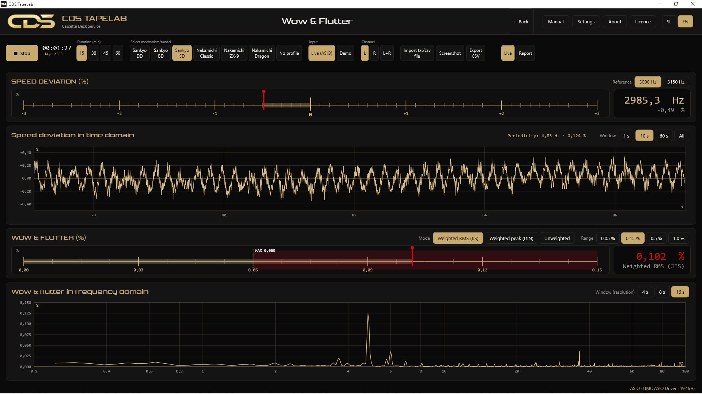
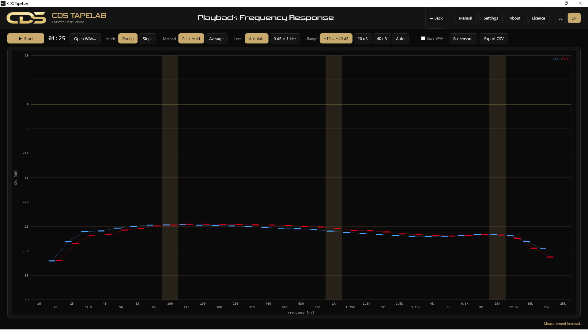
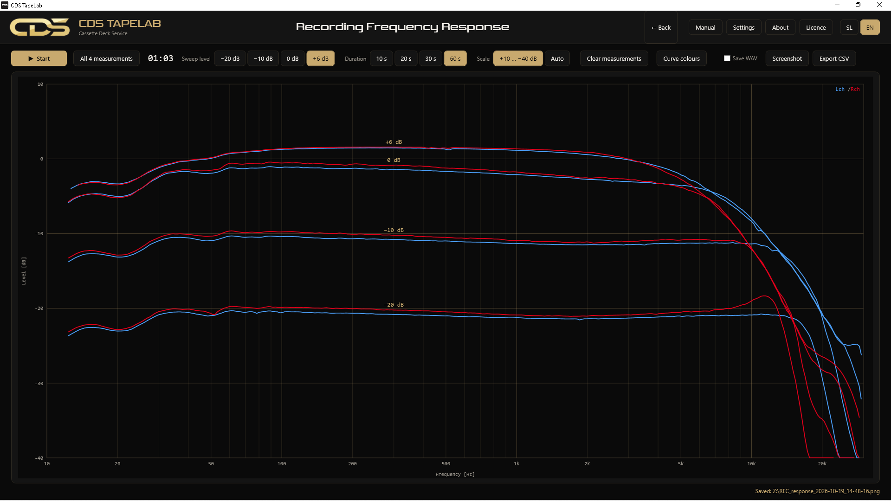
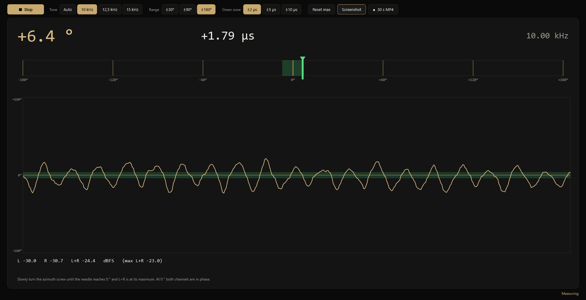

### Measurement software for cassette decks

Wow & flutter · playback and recording frequency response · head azimuth · True RMS millivoltmeter 
One program instead of several instruments. Made on the workbench by a repairer with 30+ years of cassette deck experience.

**English** · [Slovenščina](README.sl.md) · [Website](https://www.cassettedeck-service.com/tapelab.html)

 

  

## What it does

CDS TapeLab turns a normal ASIO sound card (the program works at 192 kHz, for example with a Behringer UMC202HD) into the set of instruments you need to service a cassette deck. You pick a measurement on the start screen and play a test cassette, or record a signal the program generates.

| Measurement | What you get |
|---|---|
| **Wow & Flutter** | Speed deviation in % and wow & flutter to **JIS** (weighted RMS) or **DIN** (weighted peak), measured from the 3000 or 3150 Hz test tone. Time and frequency domain, deck profiles that mark the likely rotating part. |
| **Playback Frequency Response** | How the deck reproduces a test cassette, 16 Hz – 25 kHz in 1/3-octave bands. Peak hold or average, left channel blue and right red. A recorded WAV file can be analysed later. |
| **Recording Frequency Response** | The program sends a sweep, the deck records it and the third head plays it back live. Four levels (−20, −10, 0 and +6 dB) on one chart. |
| **Head Azimuth** | Phase difference between the channels from a 10, 12.5 or 15 kHz tone as a gauge, a time trace and a delay in µs, with a ±2, ±5 or ±10 µs tolerance zone. Optional **Lissajous view**: in phase the figure is a 45° line, a phase error opens it into an ellipse, and a green ellipse marks your tolerance – turn the screw until the figure closes. |
| **True RMS Voltmeter (mV)** | AC True RMS of the left and right channel on a full-width scale. Measured ranges 9, 90, 200 and 500 mV with the nominal value at the centre, plus 1 mV – 10 V. Range per channel or locked together, calibration against a reference instrument. |

Also: a *pass-thru* reference (record the program's own signal without a cassette, then measure with a cassette at the same level and see both curves together), a combined report, import of records from other instruments (txt / csv), PNG (1600 × 800) and CSV export, Slovenian and English interface, and a user manual in both languages.

<table>
  <tr>
    <td width="50%"> Playback frequency response</td>
    <td width="50%"> Recording frequency response, four levels</td>
  </tr>
  <tr>
    <td colspan="2"> Head azimuth: gauge and phase trace</td>
  </tr>
</table>

## Download

Every release contains ready-made packages: **[latest release](https://github.com/andrej-cds/TapeLab/releases/latest)**.

| Platform | Package | Notes |
|---|---|---|
| **Windows 10 / 11** (64-bit) | `CDSTapeLab-Setup-x.y.z.exe` | Installer. Needs an ASIO driver for your sound card. |
| **Windows XP SP3** (32-bit) | `CDSTapeLab-XP-x.y.z.zip` | No installer: unpack and run `CDSTapeLab.exe`. Needs .NET Framework 4.0 and an ASIO driver (e.g. kX ASIO or ASIO4ALL). See the README inside. |
| **macOS** | — | In development (Apple Silicon and Intel). |
| **Linux** | — | Planned. |

> **Windows SmartScreen** may show a blue warning for a program from an unknown publisher: click *More info → Run anyway*.

### Hardware you need

- a computer with an **ASIO sound card** (stereo input and output; 192 kHz recommended for the full frequency range),
- a **test cassette** (3000 / 3150 Hz for wow & flutter, 10–15 kHz tone for azimuth, a frequency-response test cassette for playback response),
- for the recording measurement: a blank cassette and a deck with a third (playback) head.

The user manual is installed with the program and is also available in [`windows/Namestitev/Navodila`](windows/Namestitev/Navodila/CDS_TapeLab_User_Manual.pdf).

## Licence key

CDS TapeLab is free software (AGPL-3.0). The official builds run in *demo mode* until a key is entered: every measurement works, only the export of images and CSV is switched off. **The key is free.** I only ask you to contact me through the [website](https://www.cassettedeck-service.com/tapelab.html) so that I know who is using the program and can help if something does not work for you. In the program click *Licence*, enter the code and click *Activate*.

## Support the project

I built TapeLab for my own bench and I keep it free, because someone else will find it useful. If it saved you time, a coffee is very welcome and supports further development.

Other ways to help: star the repository, share the program with other repairers, report bugs and send ideas ([issues](https://github.com/andrej-cds/TapeLab/issues)).

## Build from source

| Edition | Folder | Needs |
|---|---|---|
| Windows 10/11 | [`windows`](windows) | .NET SDK 10, Inno Setup 6 (for the installer). Run `windows\Namestitev\Zgradi_namestitev_z_logom.bat`. |
| Windows XP | [`windows-xp`](windows-xp) | .NET SDK (it builds for .NET Framework 4.0, x86). Run `windows-xp\Namestitev\Zgradi_XP_z_logom.bat`. |

The desktop program is C# / WPF with NAudio (ASIO). GitHub Actions builds every edition: see [`.github/workflows/build.yml`](.github/workflows/build.yml). A release is created by pushing a tag such as `v0.6.0`.

Source layout: `Core` (signal processing: W&F, spectrum, azimuth, voltmeter, licence), `Controls` (charts and meters), `Views` (screens), `Assets` (icon, logo, fonts).

## Contributing

Bug reports, measurement ideas and pull requests are welcome; see [CONTRIBUTING.md](CONTRIBUTING.md). If you service decks, your experience with real equipment is worth more than any code.

## Licence

Source code: [GNU Affero General Public License v3.0](LICENSE). The name "CDS", the logo and the artwork in `docs/img` and `Assets` are not covered by the licence; see [NOTICE.md](NOTICE.md) for third-party components.

 
Made by <a href="https://www.cassettedeck-service.com"><b>Cassette Deck Service</b></a>, Ljubljana · <a href="https://www.youtube.com/CassetteDeckService">YouTube</a>

