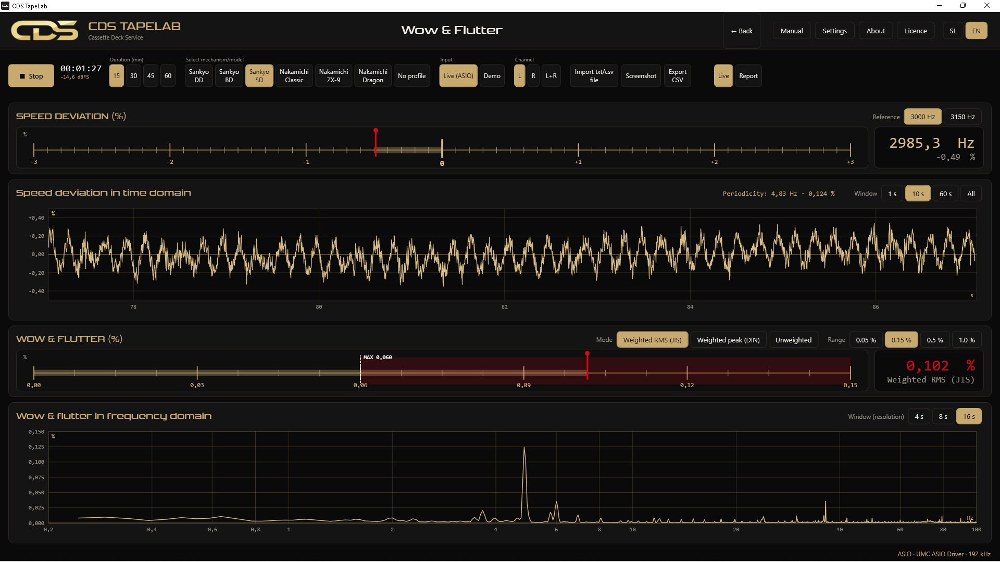
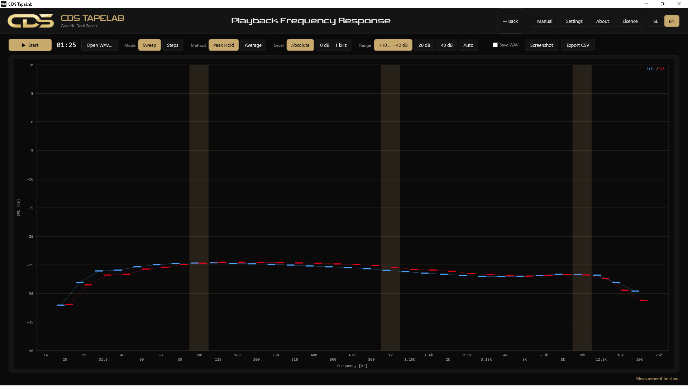
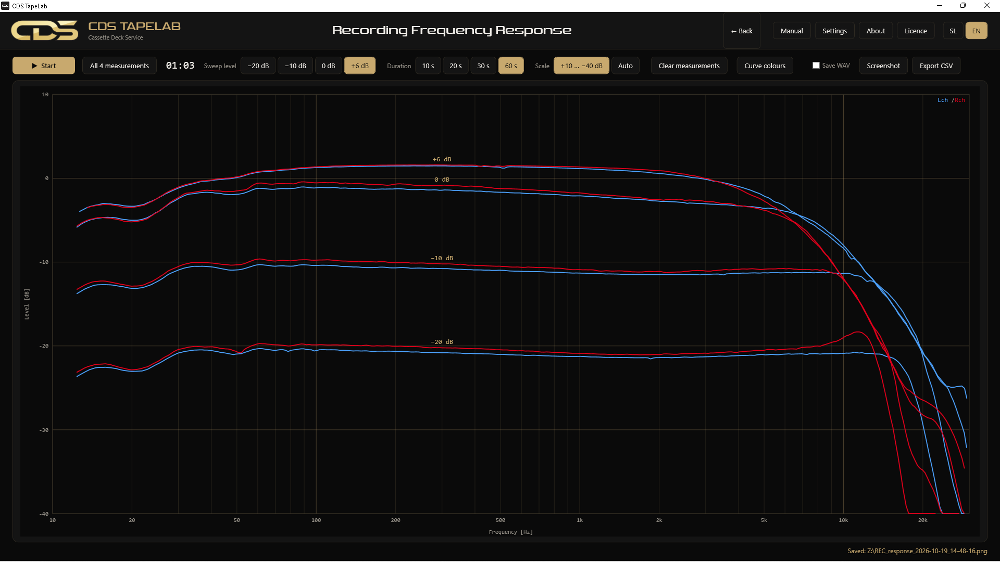
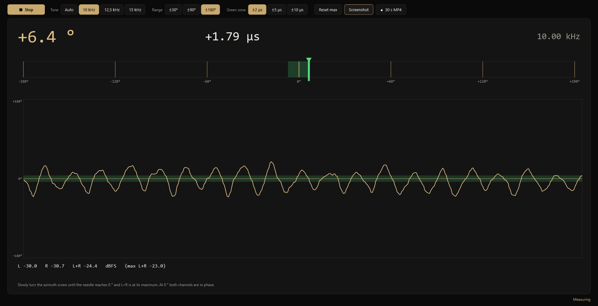

### Merilni program za kasetofone

Wow & flutter · frekvenčni odziv predvajanja in snemanja · azimut glave · True RMS milivoltmeter 
En program namesto več merilnikov. Naredil ga je serviser z več kot 30 leti izkušenj s popravili kasetofonov, na delovni mizi.

[English](README.md) · **Slovenščina** · [Spletna stran](https://www.cassettedeck-service.com/tapelab.html)

 

  

## Kaj zna

CDS TapeLab spremeni navadno ASIO zvočno kartico (program dela pri 192 kHz, na primer Behringer UMC202HD) v komplet instrumentov za servis kasetofona. Na začetnem zaslonu izbereš meritev in predvajaš testno kaseto ali posnameš signal, ki ga ustvari program.

| Meritev | Kaj dobiš |
|---|---|
| **Wow & Flutter** | Odstopanje hitrosti v % ter wow & flutter po **JIS** (utežen RMS) ali **DIN** (utežen vrh), izmerjen iz testnega tona 3000 ali 3150 Hz. Časovni in frekvenčni prikaz, profili kasetofonov označijo verjetni vrteči se del. |
| **Frekvenčni odziv predvajanja** | Kako kasetofon reproducira testno kaseto, 16 Hz – 25 kHz v tretjinskih oktavah. Peak Hold ali povprečje, levi kanal moder, desni rdeč. Posneto datoteko WAV lahko analiziraš kasneje. |
| **Frekvenčni odziv snemanja** | Program pošlje sweep, kasetofon ga posname, tretja glava ga predvaja sproti. Štiri ravni (−20, −10, 0 in +6 dB) na enem grafu. |
| **Azimut glave** | Fazna razlika med kanaloma iz tona 10, 12,5 ali 15 kHz kot merilnik, časovni potek in zakasnitev v µs, s tolerančnim območjem ±2, ±5 ali ±10 µs. Po želji **Lissajousov prikaz**: v fazi je lik črta pod 45°, fazna napaka jo odpre v elipso, zelena elipsa pa kaže tvojo toleranco – vijak vrtiš, dokler se lik ne zapre. |
| **True RMS voltmeter (mV)** | AC True RMS levega in desnega kanala na traku čez celotno širino. Merjena območja 9, 90, 200 in 500 mV z nazivno vrednostjo na sredini ter območja od 1 mV do 10 V. Območje za vsak kanal posebej ali zaklenjeno skupaj, umerjanje z referenčnim instrumentom. |

Poleg tega: *pass-thru* referenca (posnameš lasten signal programa brez kasete, nato izmeriš s kaseto na isti ravni in oba grafa vidiš skupaj), skupno poročilo, uvoz zapisov drugih merilnikov (txt / csv), izvoz slike (PNG, 1600 × 800) in CSV, slovenski in angleški vmesnik ter navodila v obeh jezikih.

<table>
  <tr>
    <td width="50%"> Frekvenčni odziv predvajanja</td>
    <td width="50%"> Frekvenčni odziv snemanja, štiri ravni</td>
  </tr>
  <tr>
    <td colspan="2"> Azimut glave: merilnik in fazni graf</td>
  </tr>
</table>

## Prenos

Vsaka izdaja vsebuje pripravljene pakete: **[zadnja izdaja](https://github.com/andrej-cds/TapeLab/releases/latest)**.

| Platforma | Paket | Opombe |
|---|---|---|
| **Windows 10 / 11** (64-bit) | `CDSTapeLab-Setup-x.y.z.exe` | Namestitveni program. Potrebuješ ASIO gonilnik za svojo kartico. |
| **Windows XP SP3** (32-bit) | `CDSTapeLab-XP-x.y.z.zip` | Brez namestitve: razpakiraš in zaženeš `CDSTapeLab.exe`. Potrebuje .NET Framework 4.0 in ASIO gonilnik (npr. kX ASIO ali ASIO4ALL). Glej README v paketu. |
| **macOS** 12+ (alfa) | `CDSTapeLab-x.y.z-macOS-apple-silicon.dmg` / `-intel.dmg` | Zgodnja različica: preizkus vhoda in voltmeter. Ni podpisana: ob prvem zagonu desni klik → Odpri. |
| **Linux** (alfa) | `CDSTapeLab-x.y.z-linux-x64.tar.gz` / `-arm64.tar.gz` | Zgodnja različica: preizkus vhoda in voltmeter. Razpakiraj in zaženi `./install.sh`. Morda potrebuje `libportaudio2` in `libjack-jackd2-0`. |

> **Windows SmartScreen** lahko pokaže modro opozorilo za program neznanega izdajatelja: klikni *Več informacij → Vseeno zaženi*.

### Kaj potrebuješ

- računalnik z **ASIO zvočno kartico** (stereo vhod in izhod; za celoten frekvenčni obseg priporočam 192 kHz),
- **testno kaseto** (3000 / 3150 Hz za wow & flutter, ton 10–15 kHz za azimut, testno kaseto za frekvenčni odziv predvajanja),
- za meritev snemanja: prazno kaseto in kasetofon s tretjo (predvajalno) glavo.

Navodila za uporabo se namestijo s programom, na voljo so tudi v [`windows/Namestitev/Navodila`](windows/Namestitev/Navodila/CDS_TapeLab_User_Manual.pdf).

## Licenčni ključ

CDS TapeLab je prosta programska oprema (AGPL-3.0). Uradne izdaje delujejo v *demo načinu*, dokler ne vneseš ključa: vse meritve delujejo, izklopljen je samo izvoz slik in CSV. **Ključ je brezplačen.** Prosim te samo, da me kontaktiraš prek [spletne strani](https://www.cassettedeck-service.com/tapelab.html), da vem, kdo program uporablja, in ti lahko pomagam, če kaj ne deluje. V programu klikni *Licenca*, vpiši kodo in klikni *Aktiviraj*.

## Podpri projekt

TapeLab sem naredil za lastno delovno mizo in ga puščam brezplačnega, ker bo komu drugemu prav prišel. Če ti je prihranil čas, je kavica zelo dobrodošla in podpira nadaljnji razvoj.

Pomagaš lahko tudi z zvezdico na repozitoriju, s predlogom programa drugim serviserjem ter s poročili o napakah in idejami ([issues](https://github.com/andrej-cds/TapeLab/issues)).

## Gradnja iz izvorne kode

| Izdaja | Mapa | Potrebuje |
|---|---|---|
| Windows 10/11 | [`windows`](windows) | .NET SDK 10, Inno Setup 6 (za namestitev). Zaženi `windows\Namestitev\Zgradi_namestitev_z_logom.bat`. |
| Windows XP | [`windows-xp`](windows-xp) | .NET SDK (gradi za .NET Framework 4.0, x86). Zaženi `windows-xp\Namestitev\Zgradi_XP_z_logom.bat`. |

Program je napisan v C# / WPF z NAudio (ASIO). Vse izdaje gradi GitHub Actions: glej [`.github/workflows/build.yml`](.github/workflows/build.yml). Izdajo ustvariš z oznako, na primer `v0.6.0`.

## Sodelovanje

Poročila o napakah, ideje za meritve in pull requesti so dobrodošli, glej [CONTRIBUTING.md](CONTRIBUTING.md). Če servisiraš kasetofone, so tvoje izkušnje z resnimi napravami vredne več kot katera koli koda.

## Licenca

Izvorna koda: [GNU Affero General Public License v3.0](LICENSE). Ime »CDS«, logotip in slike v `docs/img` ter `Assets` licence ne zajema; tretje komponente so v [NOTICE.md](NOTICE.md).

 
Naredil <a href="https://www.cassettedeck-service.com"><b>Cassette Deck Service</b></a>, Ljubljana · <a href="https://www.youtube.com/CassetteDeckService">YouTube</a>

